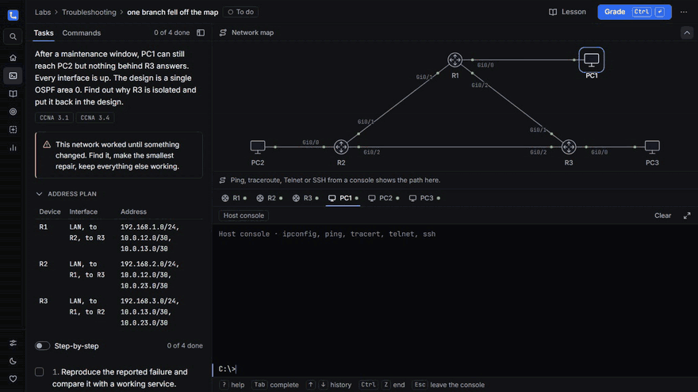
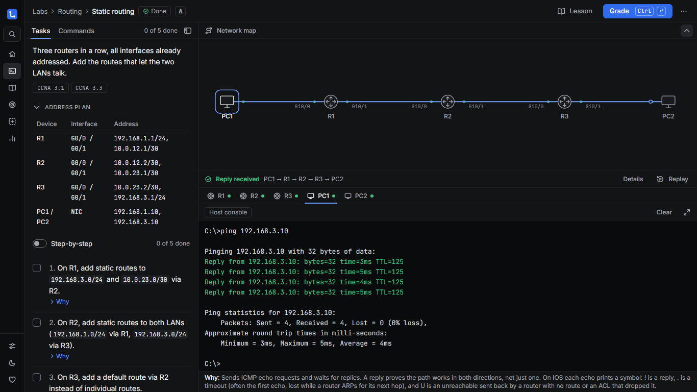
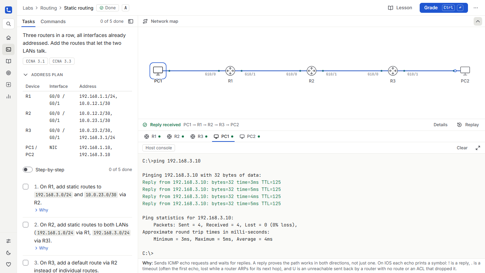
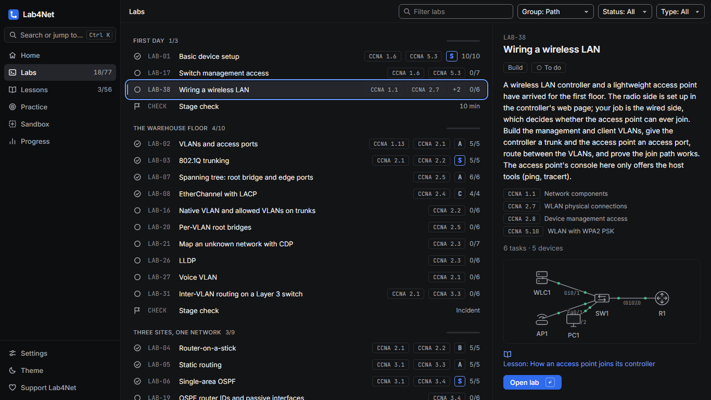
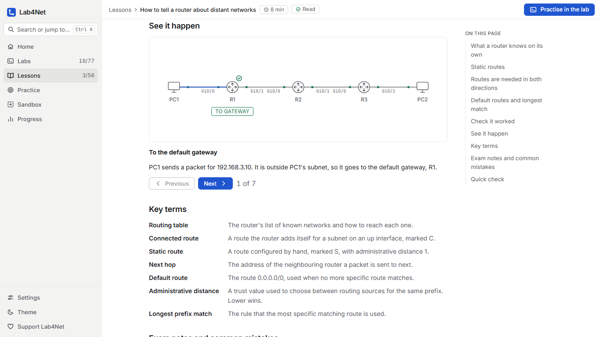
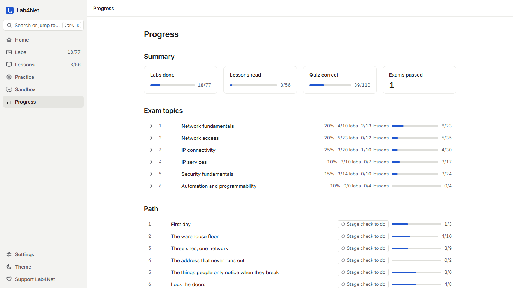
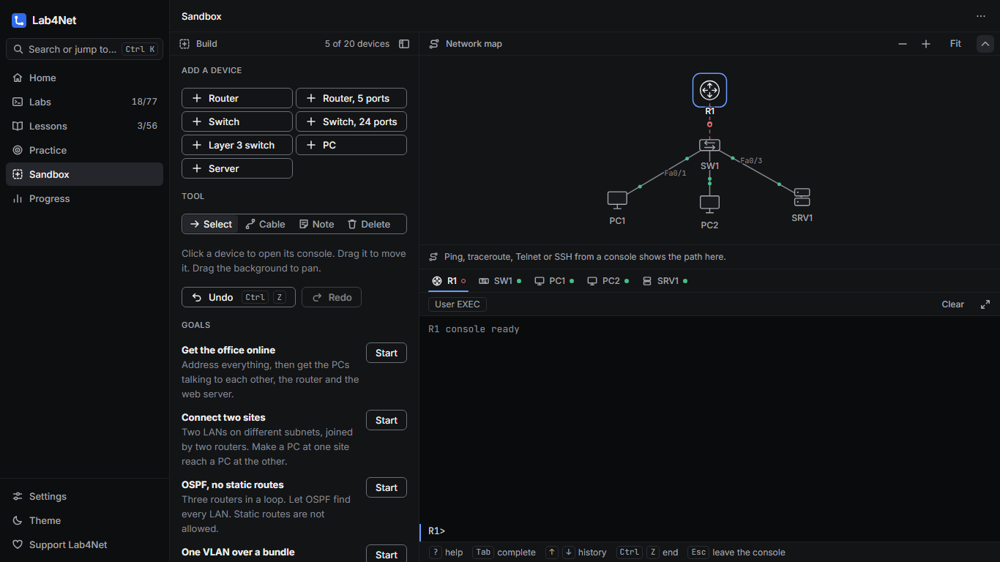

# Lab4Net

**A free, open-source CCNA lab simulator that runs in your browser.** Configure routers, switches and PCs from IOS-style consoles, watch packets cross the network map, and get graded on whether the network actually works.

**Use it now: https://yasukeblk.github.io/Lab4Net/**

No install, no account and no ads. Your progress stays in your own browser. The public site counts visits anonymously (no cookies, no personal data, and nothing at all if your browser sends Do Not Track); a copy you host yourself or open from a file sends nothing.

> Lab4Net is an independent study tool. It is not affiliated with, endorsed by or sponsored by Cisco Systems, Inc. Cisco, Cisco IOS, CCNA and Catalyst are trademarks or registered trademarks of Cisco Systems, Inc. The simulator models what the labs need; when it and real equipment disagree, trust the real equipment.

## What's inside

- **77 labs** mapped to the CCNA 200-301 v1.1 exam topics:
  - 38 build labs, covering fundamentals, switching, routing, IPv6, IP services and security
  - 37 troubleshooting incidents, where you get a broken network to fix
  - 2 capstones that build a whole network from factory defaults
  - a Path through them in eight stages, each ending in a stage check
- **One workspace** for every lab: the tasks, the network map and the console side by side, with panels you can resize, collapse or pop out to a second monitor.
- **A console that behaves like the real thing:**
  - errors with the `^` marker, `% Incomplete command` and `% Ambiguous command`
  - `?` help, Tab completion, history and `| include`
  - password prompts, Telnet and SSH sessions, and `reload`
  - live ping and traceroute output (`.!!!!`, `U.U.U`, `!H`) with ARP
  - MAC address tables, spanning tree, duplex mismatches and debug output
- **A network map** that shows every ping along the path it really takes, and where and why it failed.
- **Learning support:**
  - 56 lessons that teach the concept before the commands, also readable on the web: [free CCNA lessons](https://yasukeblk.github.io/Lab4Net/lessons/)
  - a "why" for every task and command
  - optional step-by-step help, a walkthrough, and three clues per incident
  - grades from S to D, scored on results, never on speed
- **Practice:** timed exams with hidden faults (fault-find, build, incident and a daily exam that is the same for everyone), a 110-question quiz and a subnetting drill.
- **A sandbox** to build your own network: seven device types, cabling by port, notes, undo, four goals, starter kits, and save and load to a file.
- **Progress** by exam topic, with every objective linked to its labs and lessons.
- **Backups** (Settings › Data) move your progress to another browser or device. Progress from the previous version of Lab4Net is brought over on the first visit.
- **Dark and light themes**, a command palette (`Ctrl+K`), keyboard shortcuts for everything (`?` lists them), reduced motion, and screen reader support.

| | |
| --- | --- |
|  |  |
|  |  |
|  |  |

Desktop is the main target. It works on phones too, one panel at a time, but a keyboard and a big screen make it much nicer.

## Support Lab4Net

Lab4Net is free and stays free. If it helped you study, you can say thanks at **https://buymeacoffee.com/yasukeblk**. It's entirely optional.

## Run it yourself

It's one file. Download `index.html` and open it in a modern browser. It works offline and makes no network requests (the visit counter only runs on the public site). The `lessons/` folder is the website's copy of the lessons; the app doesn't need it.

To host it on your own network:

- **nginx on Debian/Ubuntu (for example a Proxmox LXC):** copy this folder to the machine and run `bash install-lxc.sh`, then browse to `http://<machine-ip>/`. To update later: `git pull && bash install-lxc.sh`.
- **Docker:** `docker compose up -d --build`, then browse to `http://<host-ip>:8080/`.

## Contributing

Bug reports and corrections are welcome, especially anything the simulator gets wrong compared with real IOS. Please open an issue with the commands you typed, what Lab4Net printed, and what real equipment prints.

Developers: start with [`docs/DEVELOPING.md`](docs/DEVELOPING.md), which covers the file layout, the build, the engine, storage, the tests and the rules that keep every lab gradable. You edit `src/`, and the build writes `index.html`:

    npm run build        # src/ → index.html
    npm test             # every Node test (they read the built index.html)

The browser tests use Playwright, pinned in `package.json`:

    npm install
    npx playwright install chromium firefox webkit
    npx playwright test

GitHub Actions runs the build check, every Node test and the browser tests on every push.

## Licence

Lab4Net is released under the [MIT licence](LICENSE). The embedded fonts, [Inter](https://rsms.me/inter/) by Rasmus Andersson and [JetBrains Mono](https://www.jetbrains.com/lp/mono/) by JetBrains, are under the SIL Open Font License 1.1 and come from [Fontsource](https://fontsource.org/); see [`THIRD-PARTY-NOTICES.md`](THIRD-PARTY-NOTICES.md).
